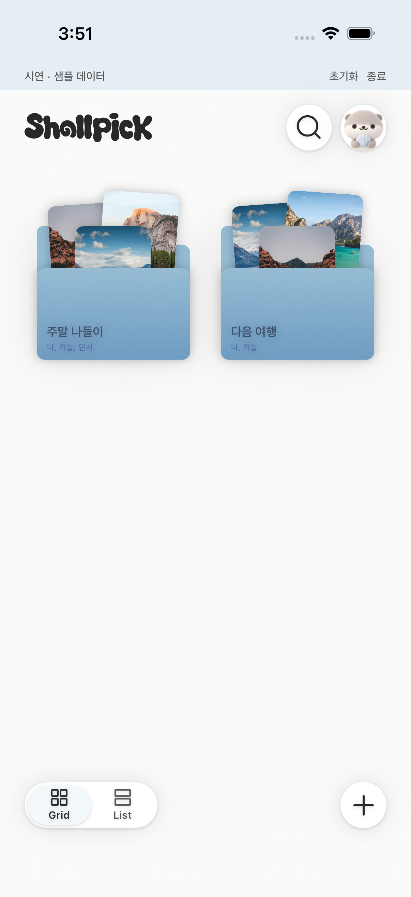
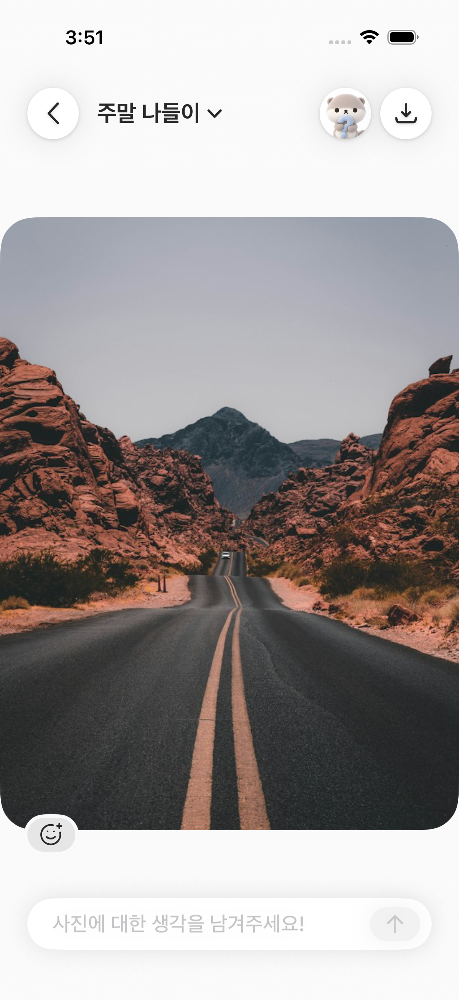
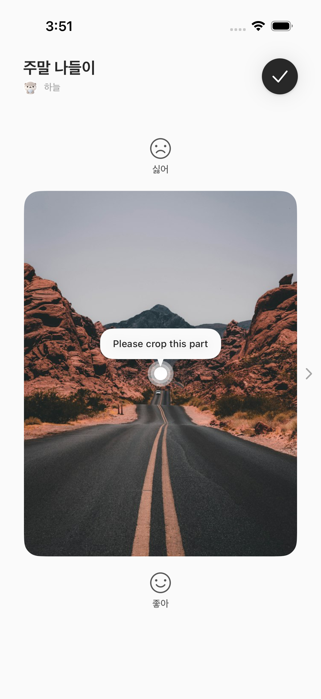
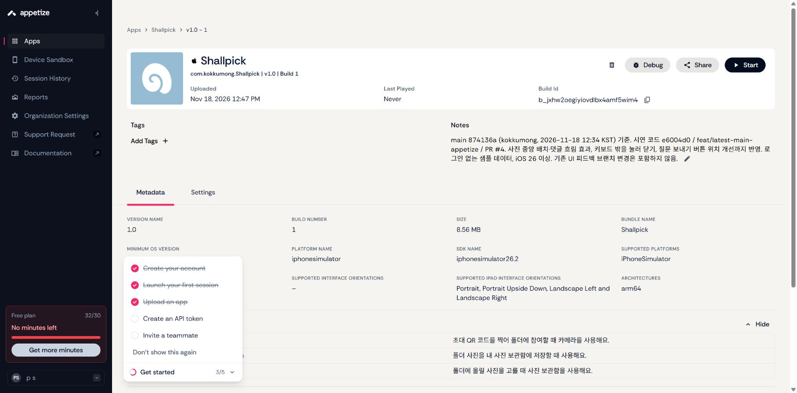

# 최신 main을 Windows에서 확인하기

기준은 kokkumong이 2026-11-18 12:34 KST까지 올린 `main`의 `874136a014403a280d10b1d33d954030dffb350d`입니다. 사진 상세, 이모지 반응과 댓글, 질문의 사진별 좋아/싫어, 위치 댓글, 질문 결과 화면을 그대로 사용합니다. 사진 중앙 배치와 댓글의 흐림 효과, 키보드 밖을 눌러 닫기, 질문 작성 화면의 보내기 버튼 위치 개선까지 반영했습니다. 기존 `feat/ui-feedback`의 UI 변경은 섞지 않았습니다.

`feat/latest-main-appetize`에서는 로그인 없이 확인할 수 있도록 샘플 데이터만 연결했습니다. 화면과 제스처는 최신 main 구현을 사용하며, 홈의 시연 표시와 초기화/종료만 추가했습니다. 샘플 의견은 실제 친구의 답변이 아닙니다. 변경 내용은 현재 실행 세션에서만 유지되고 초기화 또는 앱 종료 후 사라집니다.

## 실행 순서

1. Appetize에서 iOS 26 이상을 선택합니다.
2. 로그인 없이 둘러보기 → 주말 나들이 → 오른쪽 위 채팅을 엽니다.
3. 친구 질문의 확인하러가기를 누릅니다.
4. 사진을 아래로 넘겨 좋아, 위로 넘겨 싫어를 남깁니다. 좌우 이동은 사진을 바꿉니다. 댓글 핀은 누르는 버튼이므로, 스와이프는 핀과 겹치지 않는 사진 영역에서 시작합니다.
5. 사진의 한 지점을 길게 누르면 그 위치에 댓글을 남길 수 있습니다.
6. 내 질문의 확인 현황 버튼에서는 샘플 답변 결과와 위치 댓글을 확인합니다.

폴더 사진을 누르면 별도의 사진 상세 화면이 열립니다. 사진 두 번 누르기와 이모지 반응, 일반 댓글도 확인할 수 있습니다. 현재 버전의 ‘좋아/싫어’ 의미는 팀과 추가 논의할 항목이며, 게시 동의로 새롭게 재정의하지 않았습니다.

## 빌드와 업로드

GitHub Actions에서 일반 앱과 시연 앱을 컴파일합니다. 산출물 ZIP을 한 번 풀고 그 안의 `Shallpick-Appetize.zip`을 업로드합니다. 업로드용 ZIP의 최상단에는 `Shallpick.app/Info.plist`와 실행 파일이 있어야 합니다. GitHub 산출물 바깥 ZIP이나 소스 ZIP을 그대로 올리면 실행 앱을 찾지 못합니다.

- 앱: ARM64 iOS Simulator, 최소 iOS 26.
- 인증정보: 시연 빌드는 빈 설정으로 만들고 Supabase/Kakao 초기화를 차단합니다.
- 서버 데이터와 실제 다중 사용자 동기화: 이 시연의 검증 범위에 포함하지 않습니다.
- 실기기 사진 업로드: 시연에서는 샘플 사진 추가로 대체합니다.
- [Appetize 실행 페이지](https://appetize.io/app/b_jxhw2oegiyiovdlbx4amf5wim4?device=iphone14pro&osVersion=26.0&toolbar=true)
- [등록된 빌드 정보](https://appetize.io/apps/ios/com.kokkumong.Shallpick/builds/b_jxhw2oegiyiovdlbx4amf5wim4)
- [검토용 PR #4](https://github.com/kokkumong/Shallpick/pull/4)

## 검증 기록 — 2026-11-18

| 항목 | 결과 |
| --- | --- |
| 기준 팀 작업 | main `874136a` |
| 실행용 코드 | `e6004d0` |
| 일반 앱 컴파일 | 통과 |
| 오프라인 시연 앱 컴파일 | 통과 |
| 업로드 ZIP | 최상단 .app, Info.plist, ARM64 실행 파일, ZIP 무결성 확인 |
| 인증 설정 | Kakao와 Supabase 값이 비어 있는지 확인 |
| Appetize 등록 | 성공. iPhoneSimulator / arm64 / 최소 iOS 26.0 인식 |
| Appetize 스트리밍 | 최신 빌드는 시작하지 않음. 계정에 No minutes left가 표시되며, 사용자는 업로드와 시뮬레이터 검증까지 요청. 이전 업로드 `5a6dffa`의 홈 화면이 열린 것은 확인 |
| iPhone 자동 UI 검증 | 홈, 폴더, 사진 상세, 질문 답변 진입 및 위치 댓글 저장·재진입 확인. 사진별 답변은 테스트 제스처 수정 후 재검증 중 |

업로드 ZIP SHA-256: `f0d1c7ea01e08dc1dcccaf9c62eeca1582cd682141289c717187c3b97440b12b`

[업로드 앱 빌드 기록](https://github.com/kokkumong/Shallpick/actions/runs/44232377129). 이후 앱 소스는 동일하며, [수정된 자동 검증](https://github.com/kokkumong/Shallpick/actions/runs/44233725132)은 `522fdea`에서 실행합니다.

## 실제 시뮬레이터 화면

| 홈 | 사진 상세 | 위치 댓글 |
| --- | --- | --- |
|  |  |  |

기준: [Appetize iOS 업로드 안내](https://docs.appetize.io/platform/app-management/uploading-apps/ios).
