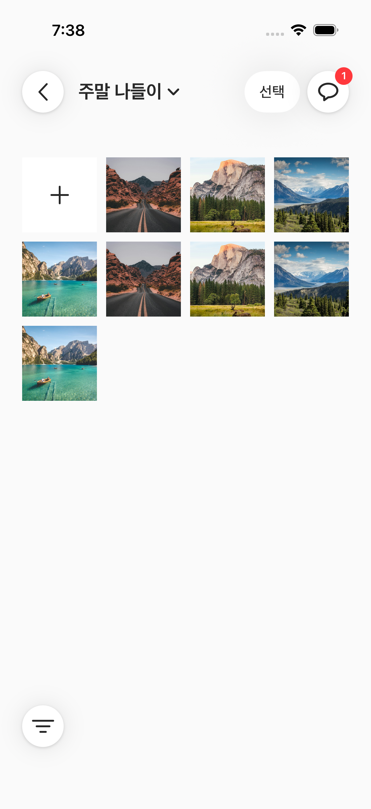
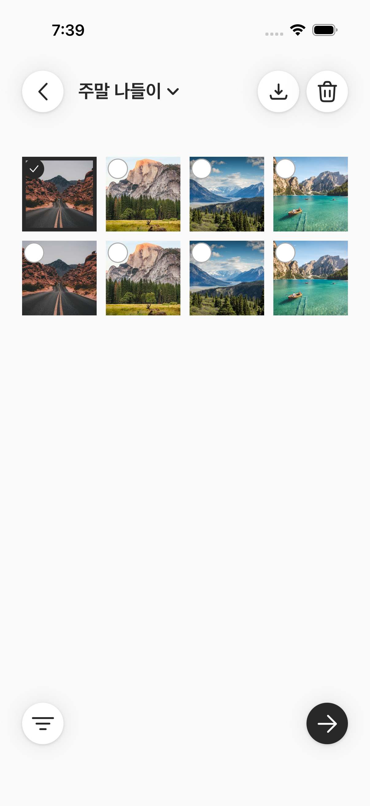
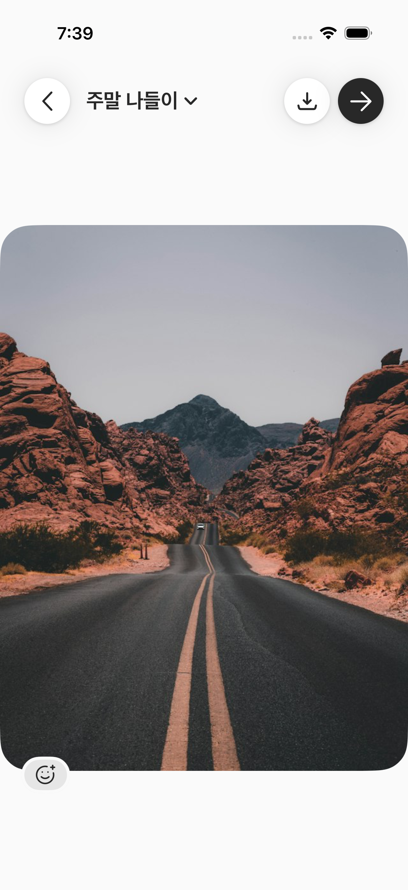

# Figma ‘수정할것’ 반영

기준은 `main`의 `42f76f35c3ff871387658f11189027f46152f8a3`와 [수정할것](https://www.figma.com/design/81LoE3oB0Hh6Rxy6OT7Uce/HCI?node-id=701-23676)이다. 이 영역의 네 화면, 댓글 6건, 화면 아래 설명 세 개를 대조했다.

## 반영 범위

| 화면 | Figma 근거 | 변경 |
| --- | --- | --- |
| 폴더 | 701:24531, 댓글 2016157961 | 상단 ‘선택’으로 기존 선택 모드 진입. 첫 그리드 칸에서 사진 추가. |
| 사진 선택 | 701:24689, 댓글 2016158490·2016158730 | 길게 누르기도 동일 선택 모드 사용. 하단 화살표로 기존 질문 작성 화면 연결. 빈 선택에서는 진행 불가. |
| 사진 상세 | 701:25132, 댓글 2016159004·2016159327, 설명 701:25247 | 일반 탭으로 상세 열기. 저장 옆 화살표로 질문 작성. 상시 입력창과 아래 댓글 목록을 제거하고 길게 누른 위치에 댓글 작성. 말풍선에는 설정된 닉네임 표시. |
| 요청 응답 | 701:25193, 댓글 2016160166, 설명 701:25248 | 사진 아래 좋아/싫어 버튼으로 투표. 저장 성공 후 다음 미응답 사진으로 이동. 이전 사진을 검토하고 변경할 수 있으며 상단 체크로 완료. |

기존 색상, 아이콘, 폴더 그리드, 핀치, 드래그 선택, 사진 저장, 이모지 반응과 질문 작성 화면을 재사용한다. 선택 모드의 종료 버튼도 유지한다. 다른 Figma 영역과 취소했던 PR #6은 포함하지 않는다.

## 댓글 데이터 적용

`supabase/migrations/20261119185928_photo_comment_positions.sql`은 기존 `photo_comments`에 선택적인 `x`, `y`만 추가한다. 두 값은 사진 안의 0~1 비율이다. 기존 댓글, 권한 정책, 테이블 관계는 유지한다.

- 앱 배포 전 해당 마이그레이션을 Shallpick 데이터베이스에 적용해야 한다.
- 위치가 없는 과거 댓글은 사진 위 ‘이전 댓글’에서 읽을 수 있다. 임의 위치로 소급하지 않는다.
- 입력은 저장 성공 후 닫는다. 실패하면 문구와 위치를 보존한다.
- 이 작업에서 원격 데이터베이스를 변경하지 않았다. 실제 두 계정 간 저장/조회는 별도 확인이 필요하다.

## 검증

- 로컬 PostgreSQL 엔진(PGlite 0.5.17)에서 마이그레이션 적용 확인: 기존 댓글의 null 좌표, 정상 좌표와 경계값, 범위 밖 값/한쪽 null/NaN/Infinity 거부, RLS 유지.
- [일반/시연 빌드](https://github.com/kokkumong/Shallpick/actions/runs/44594676186): 두 빌드 모두 통과. 이 실행의 시뮬레이터 준비는 시간 초과로 실패했고, 이후 멈춘 종료 작업은 취소했다.
- [ARM 시뮬레이터 실행](https://github.com/kokkumong/Shallpick/actions/runs/44598891689): 시연 빌드, 사진 추가 화면 열기, 선택/길게 누르기, 질문 작성 연결, 사진 상세와 댓글 입력까지 확인했다. 실패 응답 후 입력 문구는 남아 있었으나 자동 검사에서 입력 완료 후 달라진 입력창 이름을 찾지 못해 중단됐다. 검사 식별 방식을 수정한 재실행은 진행 중이다.
- 검증 브랜치의 오프라인 데이터로 실행한다. 실제 사용자 응답이나 실제 계정 간 검증을 뜻하지 않는다.

## 실제 앱 캡처

아래 이미지는 변경 코드 `87b2f1e`에 오프라인 시연 데이터만 연결한 iOS 시뮬레이터 캡처다. Figma 목업이 아니다. 원본 파일과 실행 정보는 `capture-provenance.json`에 기록했다.

| 폴더 | 사진 선택 | 사진 상세 |
| --- | --- | --- |
|  |  |  |

## 팀에서 확인할 핵심 동작

1. 폴더 첫 + 칸에서 사진 추가 화면을 연다. ‘선택’ 또는 사진 길게 누르기로 선택하고, 화살표로 질문 작성 화면을 연다. 선택 종료와 기존 핀치/드래그 선택도 확인한다.
2. 사진을 일반 탭으로 열면 상시 입력창이 없어야 한다. 사진을 길게 눌러 댓글을 남기고, 다른 계정에서 같은 사진을 다시 열어 위치와 닉네임을 확인한다.
3. 요청 사진에서 좋아/싫어 버튼으로 답한다. 이전 사진으로 돌아가 답을 변경하고, 모든 사진에 답한 뒤 체크로 마무리한다.
4. 연결이 끊겼을 때 투표가 다음 사진으로 넘어가지 않는지, 댓글 입력이 보존되는지 확인한다. 미응답 상태에서 체크하면 이어서 답하거나 나중에 할 수 있어야 한다.
