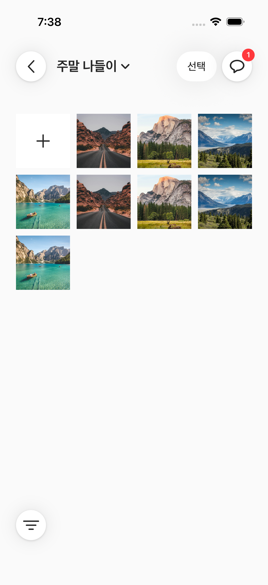
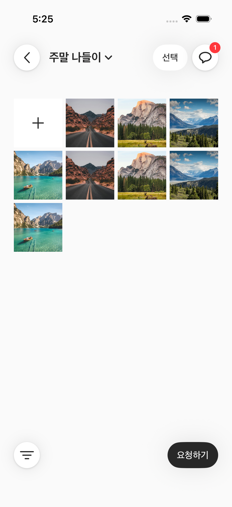
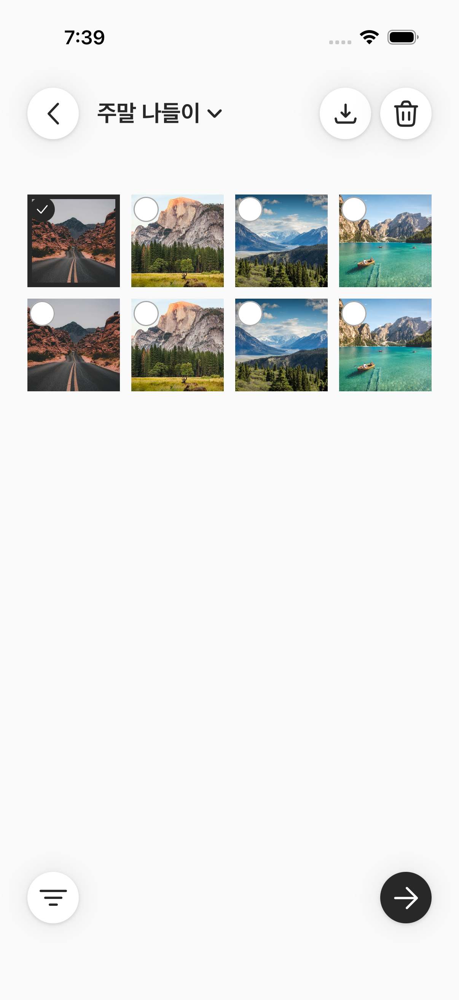
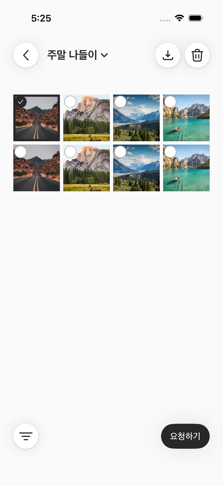

# 갤러리 간격과 요청하기 버튼

사용자 첨부 이미지와 Figma [수정 11월20 오후3:07 — 폴더안](https://www.figma.com/design/81LoE3oB0Hh6Rxy6OT7Uce/HCI?node-id=778-9411)을 기준으로 갤러리만 수정했다. 같은 이름의 다른 영역에는 흰색 버튼도 있지만, 첨부 이미지의 검정색 시안을 적용했다.

## 변경

- 사진 사이 가로·세로 간격을 10pt에서 6pt로 줄였다. Figma의 간격 값은 10pt이며, 더 좁혀 달라는 별도 요청을 반영한 값이다. 기존 바깥 여백과 핀치 열 수 설정은 유지한다.
- 우측 하단은 검정색 캡슐형 ‘요청하기’다. 기존 색상, 글자 스타일, 그림자와 누름 효과를 재사용했다. 높이 45pt, 좌우 안쪽 여백 16pt다.
- 일반 갤러리에서 누르면 기존 선택 모드로 들어간다. 사진을 고른 뒤 다시 누르면 기존 질문 작성 화면을 연다. 선택이 비어 있거나 처리 중이면 다음 단계로 진행하지 않는다.
- 상단 ‘선택’, 길게 누르기, 필터, 사진 추가와 선택 취소 동작은 유지한다. 사진 상세의 화살표와 요청 응답 화면은 이번 변경 대상이 아니다.

앱 변경은 `FolderDetailView.swift` 한 파일이며, 코드 커밋은 `ec8f096`이다. 이전 변경과 함께 PR #7에서 검토한다.

## 검증

[iOS 시연 빌드와 시뮬레이터 검사](https://github.com/kokkumong/Shallpick/actions/runs/44780820891)를 통과했다. iPhone 17 Pro 시뮬레이터의 오프라인 시연 데이터로 다음 동작을 확인했다.

- 일반 갤러리의 ‘요청하기’에서 기존 선택 모드로 진입
- 선택한 사진이 없을 때 요청 차단, 사진 선택 후 활성화
- 기존 질문 작성 화면 연결과 작성 취소 후 선택 유지
- 선택 해제 시 다시 비활성화, 선택 모드 종료와 상단 ‘선택’ 진입

실제 계정 간 전송은 검증하지 않았다. 새 DB 변경은 없다.

## 수정 전후

모두 실제 iOS 시뮬레이터 캡처다. 수정 전은 이전 PR 검증본이며, 수정 후는 위 검사에서 생성한 원본이다. 캡처 출처와 파일 해시는 [capture-provenance.json](capture-provenance.json)에 기록했다.

| 상태 | 수정 전 | 수정 후 |
| --- | --- | --- |
| 일반 갤러리 |  |  |
| 사진 선택 |  |  |
