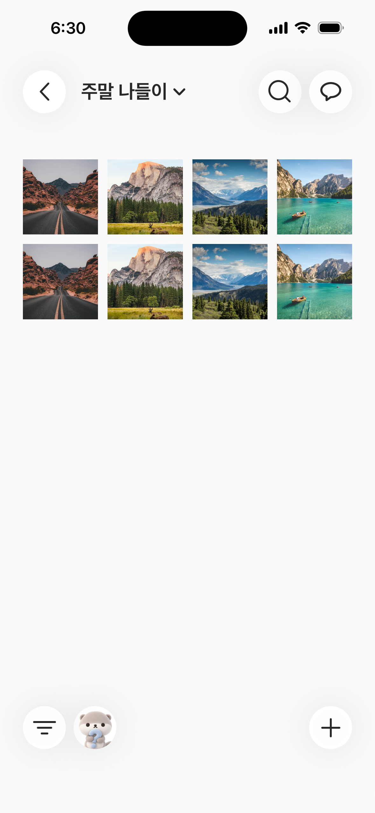

# Figma 댓글 반영 — 홈과 폴더

작업 브랜치: `feat/ui-feedback`. 기준판: `feat/browser-demo`의 `eaf9c07`.
2026-11-17에 확인한 [앱 캡처 페이지](https://www.figma.com/design/81LoE3oB0Hh6Rxy6OT7Uce/HCI?node-id=486-4025)의 미해결 댓글 9개를 반영합니다.

| 화면 | 댓글 | 반영 |
| --- | --- | --- |
| 홈 | 그리드 제거, 리스트만 유지 | 리스트로 고정하고 전환 버튼 제거 |
| 홈 | 검색 제거 | 검색 버튼과 검색 진입 제거 |
| 홈 | 알림을 상단 우측으로 | 설정 왼쪽에 알림 배치 |
| 홈 | 설정 아이콘 또는 프로필로 변경 | 수달을 톱니바퀴로 교체, 기존 계정 메뉴 연결 |
| 폴더 | 필터 제거 | 폴더 하단 필터 제거 |
| 폴더 | 수달 제거 | 폴더 하단 수달 제거, 사진 질문은 채팅에서 작성 |
| 폴더 | 사진 추가를 좌측 하단으로 | 사진 추가 버튼 왼쪽 아래 배치 |
| 폴더 | 채팅을 우측 하단으로 | 채팅 버튼 오른쪽 아래 배치 |
| 폴더 | 확대·축소로 2×2~5×5 배열 전환 | 핀치로 가로 2~5열 전환. 행은 사진 수에 따라 이어짐. 애니메이션과 동작 줄이기 지원 |

댓글 ID: `2011659110`, `2011660376`, `2011660717`, `2011682245`, `2011679366`, `2011679295`, `2011677688`, `2011677495`, `2011676689`.
수달 ‘제거’ 댓글은 최신 ‘설정 아이콘 또는 프로필로 변경’ 요청으로 대체되었습니다.

## 확인 순서

1. 로그인 없이 둘러보기 → 홈의 리스트, 상단 알림과 설정, 하단 폴더 추가.
2. 주말 나들이 → 왼쪽 아래 사진 추가, 오른쪽 아래 채팅.
3. 사진 위에서 두 손가락을 벌리면 확대(최소 2열), 오므리면 축소(최대 5열).
4. 채팅 → 수달 → 사진 선택 → 다음 → 질문 전송.

## 수정 전후 화면

수정 전 PNG는 사용자가 Figma에 붙인 실제 앱 캡처 원본입니다. 변경 후 화면과 검증 결과는 새 빌드 실행 후 추가합니다.

| 홈 수정 전 | 폴더 수정 전 |
| --- | --- |
|  |  |

## 검증 상태

- iOS 일반/시연 빌드: 진행 예정.
- Appetize 실행 및 변경 화면 확인: 진행 예정.
- 자동 UI 테스트: 버튼 위치, 2~5열 핀치 제한, 사진 추가와 채팅 전송 회귀 검증을 준비했습니다. 실행 결과는 별도로 기록합니다.
- 폴더 상단 검색은 기존에 동작이 연결되지 않은 상태입니다. 이번 댓글은 홈 검색 제거를 지시했으므로 폴더 검색은 그대로 두었습니다.
