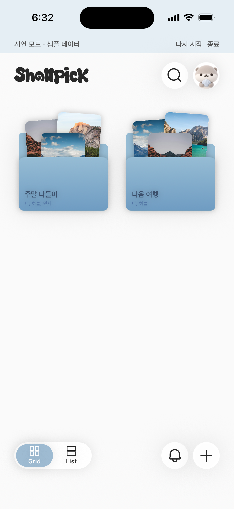
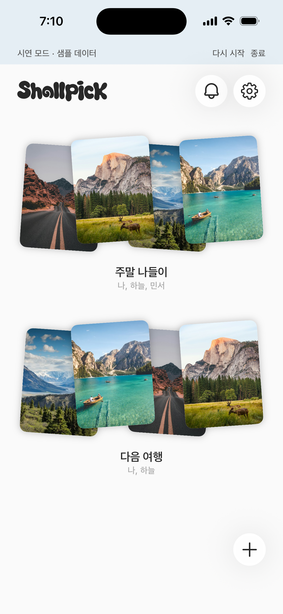

# Figma 댓글 반영 — 홈과 폴더

작업 브랜치: `feat/ui-feedback`. 기준판: `feat/browser-demo`의 `eaf9c07`.
2026-11-17에 확인한 [앱 캡처 페이지](https://www.figma.com/design/81LoE3oB0Hh6Rxy6OT7Uce/HCI?node-id=486-4025)의 미해결 댓글 9개를 반영합니다.

| 화면 | 댓글 | 반영 |
| --- | --- | --- |
| 홈 | 그리드 제거, 리스트만 유지 | 리스트로 고정하고 전환 버튼 제거 |
| 홈 | 검색 제거 | 검색 버튼과 검색 진입 제거 |
| 홈 | 알림을 상단 우측으로 | 설정 왼쪽에 알림 배치 |
| 홈 | 설정 아이콘 또는 프로필로 변경 | 수달을 톱니바퀴로 교체, 기존 계정 메뉴 연결 |
| 폴더 | 필터 제거 | 폴더 하단 필터 제거 |
| 폴더 | 수달 제거 | 폴더 하단 수달 제거, 사진 질문은 채팅에서 작성 |
| 폴더 | 사진 추가를 좌측 하단으로 → 후속 요청에서 첫 그리드 칸으로 변경 | 왼쪽 위 첫 칸을 사진 추가 타일로 사용. 별도 하단 + 버튼 제거 |
| 폴더 | 채팅을 우측 하단으로 | 채팅 버튼 오른쪽 아래 배치 |
| 폴더 | 확대·축소로 2×2~5×5 배열 전환 | 핀치로 가로 2~5열 전환. 행은 사진 수에 따라 이어짐. 애니메이션과 동작 줄이기 지원 |

댓글 ID: `2011659110`, `2011660376`, `2011660717`, `2011682245`, `2011679366`, `2011679295`, `2011677688`, `2011677495`, `2011676689`.
수달 ‘제거’ 댓글은 최신 ‘설정 아이콘 또는 프로필로 변경’ 요청으로 대체되었습니다.

## 확인 순서

1. 로그인 없이 둘러보기 → 홈의 리스트, 상단 알림과 설정, 하단 폴더 추가.
2. 주말 나들이 → 왼쪽 위 첫 타일에서 사진 추가, 오른쪽 아래 채팅.
3. 사진 위에서 두 손가락을 벌리면 확대(최소 2열), 오므리면 축소(최대 5열).
4. 채팅 → 수달 → 사진 선택 → 다음 → 질문 전송.

## 수정 전후 화면

수정 전 PNG는 사용자가 Figma에 붙인 실제 앱 캡처 원본입니다. 홈 수정 후 PNG는 Appetize에서 실행한 `15c9544`의 실제 iOS 앱 캡처입니다. 그 이후 홈은 변경하지 않았습니다. 첫 칸 추가 타일을 적용한 폴더 화면은 새 빌드 검증 후 추가합니다.

| 화면 | 수정 전 | 수정 후 |
| --- | --- | --- |
| 홈 |  |  |
| 폴더 |  | `f5e2b16`의 빌드 및 캡처 대기 |

## 후속 UX 설계

[Figma 검토 페이지](https://www.figma.com/design/81LoE3oB0Hh6Rxy6OT7Uce/HCI?node-id=508-4025)에 기존 디자인을 보존한 별도 흐름을 만들었습니다.

- 합의한 목적: SNS에 올려도 되는지 사진에 나온 친구에게 확인.
- 합의한 진입: 폴더에서 사진 선택 → 의견 요청.
- 사진 추가 타일은 이 브랜치에 반영했습니다. 공개 여부 요청과 친구 답변 화면은 후속 설계이며 현재 앱에 구현됐다고 간주하지 않습니다.
- 사진별 답변 방식, 공개 범위 표시, 수정 후 재확인은 사용자와 논의 중입니다.

## 검증 상태

- iOS 일반/시연 빌드: `15c9544`와 `d5c9e7d` 통과. 첫 칸 추가 타일을 적용한 `f5e2b16`은 [새 실행](https://github.com/kokkumong/Shallpick/actions/runs/44103034642)에서 Mac 실행기 배정 대기 중입니다.
- [Appetize 댓글 반영 버전](https://appetize.io/app/b_hyjx2ncjwddabierybfwtsynwy?device=iphone14pro&osVersion=26.0&toolbar=true): `15c9544`. 실제 홈 리스트와 상단 알림/설정, 폴더의 4열 사진과 하단 추가/채팅을 확인했습니다. 후속 타일 변경은 아직 이 버전에 포함되지 않습니다.
- 자동 UI 테스트: 첫 실행의 테스트 제품 이름 오류와 다음 실행의 사진 버튼 조회 코드 오류를 수정했습니다. 수정한 테스트의 실행 및 핀치 검증은 아직 통과하지 않았으며 결과 대기 중입니다.
- 폴더 상단 검색은 기존에 동작이 연결되지 않은 상태입니다. 이번 댓글은 홈 검색 제거를 지시했으므로 폴더 검색은 그대로 두었습니다.
